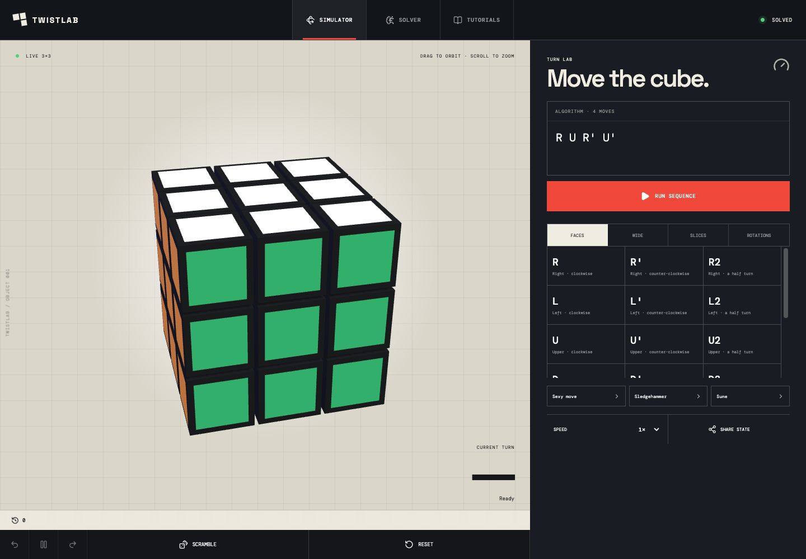

<h1 align="center">TwistLab</h1>

[Portfolio case study](https://ompatnaik.com/projects/twistlab/) · [Live cube simulator](https://ompatnaik.com/TwistLab/)

**Play an algorithm on a 3×3 cube and turn the current scramble into a guided solving lesson.**

[Demo or published artifacts](https://ompatnaik.com/TwistLab/)

WebGL browser app. Node.js and npm for development. Puzzle state is separate from rendering.

By Om Patnaik · repository created August 2026.



## Install

| Platform / path | Start here |
| --- | --- |
| Browser | [Launch TwistLab](https://ompatnaik.com/TwistLab/) |
| From source | `npm install`, then `npm run dev` |

Open the Vite URL, enter an algorithm, and play it one move at a time. Use the live simulator for a no-install trial.

```bash
npm run dev
```

## Why

You can read a cube algorithm without understanding what each move changes. TwistLab combines notation playback with a tracked cube state and lessons tied to the current scramble. The implemented puzzle is the 3×3 cube.

## Follow your current cube

Scramble, undo, redo, and select a tutorial track. Step through white-cross and later learning phases while the virtual cube follows the moves.

## Try a method case

Browse Beginner, CFOP, Roux, and ZZ concepts. Prepare a card’s example state, animate its algorithm, and share an algorithm URL.

## Notes from building it

I separated cube state from rendering so moves can be checked without WebGL. The tutorial workflow uses that state to keep the lesson tied to the actual scramble. I would extend the same checks before adding another puzzle.

## Commands

```bash
npm run dev                     # start the simulator
npm run test                    # check notation, cube state, and solver
npm run lint                    # lint source
npm run build                   # type-check and build
```

## Verify it yourself

```bash
npm run test
npm run lint
npm run build
```

Tests cover notation, deterministic cube state, and solver behaviour. Browser animation, touch controls, and guided playback also need a manual check; passing state tests does not prove every interaction.

## Credits, license and pointers

Built with React, Three.js, Vite, Lucide, and `rubiks-cube-solver`. No source license file is present.

[Full setup, original notes, and project history](README-DETAILS.md).
